

# 御枢 · AegisOps

### 让情报关联资产，让告警进入处置，让结论回到证据。

一套连接模型、智能体、工作流与安全运营场景的开源工作台。

[下载部署](https://github.com/knot07/AegisOps/releases/latest) · [部署与操作](DEPLOY.md) · [Windows 安装](WINDOWS.md) · [本次更新](docs/CHANGELOG-2026.11.18.md) · [页面导览](#页面导览)

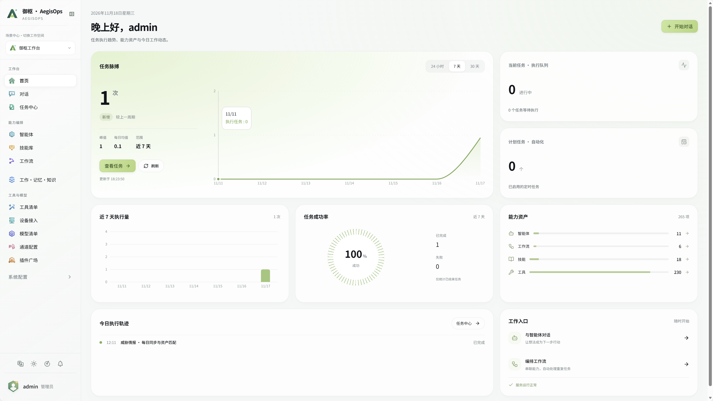

## 2026.11.18：从看见风险，到核查与闭环

这次更新增加了**威胁情报场景、官方来源直采、Atlas 资产情报核查**，并将 Solar 接入已有的授权取证流程。按钮、搜索框、日期选择、字体和卡片尺寸统一到工作台主题。下方全部截图均在本次版本重新拍摄，业务示例使用隔离演示数据。

| 本次更新 | 实际变化 |
| --- | --- |
| 情报直接采集 | 平台自行访问七家官方来源并解析入库，不再依赖第三方项目发布的数据库 |
| 来源状态透明 | 分来源记录条数、最近成功时间和错误；单源失败不覆盖历史数据 |
| 每日更新工作流 | 直采 → 去重入库 → 资产产品匹配 → 待核实线索，任务中心定时执行，默认关闭 |
| Atlas 资产核查 | 只读查询真实资产、产品版本和情报记录，核对公告范围及利用前提，生成有出处的分析 |
| Solar 辅助取证 | 授权 Linux SSH 自主调查时调用官方固定版本采集器，原件、文本报告及校验值归档到事件证据 |
| 轻量发行 | REA 不再随主包分发；Windows 首次启动自动准备主要依赖，下载结果本地复用 |

## 四个工作空间，贯通日常运营

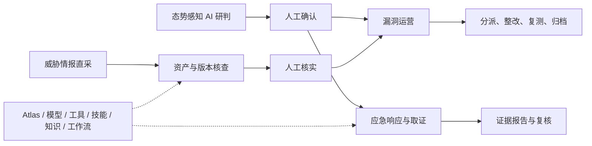

### 态势感知 AI 研判

从设备告警进入研判，保留来源设备与原始线索。确认攻击后，可将事件转入应急响应，或将漏洞转入漏洞库。演示环境与正式接入分别保留；非预置设备需按真实 API 和日志样本适配，不能仅修改名称后视为接入完成。

### 漏洞运营

统一资产目录与漏洞台账，支持搜索、编辑、删除、资产关联、整改分派、提交复测和历史归档。管理员同样可以完成复测。资产拓扑与趋势帮助查看业务关联，Atlas 可协作整理录入资料。

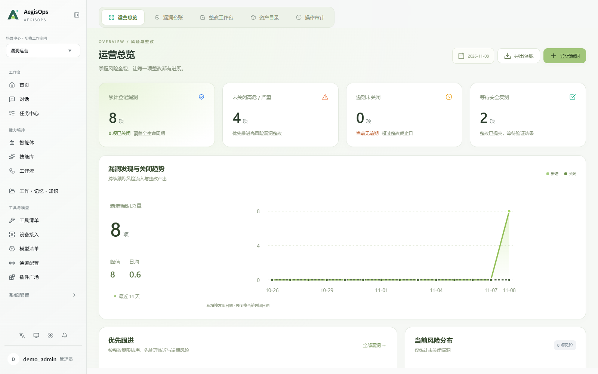

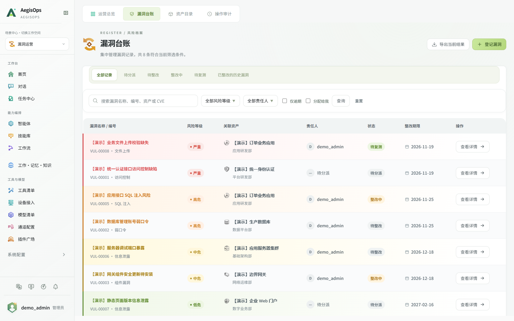

### 应急响应

事件接收 → 来源设备日志关联 → 授权主机排查 → 文件取证与分析 → 证据报告 → 人工复核。Linux 支持 SSH，Windows 支持 WinRM HTTPS。AI 根据实际证据继续追查，报告引用证据编号，不将建议写成已执行动作。

Solar 作为调查背后的辅助工具使用。Linux 采集受主机登记、指纹、权限、超时及尺寸限制约束；失败会留下记录并继续使用已有证据。Windows 使用固定 WinRM 模板，当前不宣称能后台执行 Solar 的图形工具。

样本支持静态初筛、可选 REA/Ghidra 静态逆向、微步与 VirusTotal 查询或明确确认后的上传。REA 环境按需安装，使用 Linux/WSL2 工作环境；不提供运行恶意样本的动态沙箱，也不把字符串匹配称为深度逆向。

### 威胁情报

首页仅展示七个来源入口：微步、阿里云、斗象、长亭、NVD、Tenable、CISA。进入来源后查看具体公告，按日期、等级或关键词筛选，保留原文链接和模型辅助中文译文。采集遵循公开接口或官方订阅，来源限制会如实显示，不伪造更新成功。

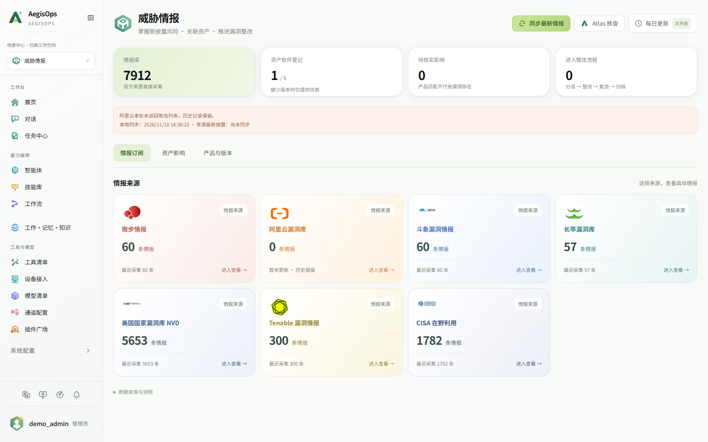

Atlas 的这个入口专门用于**核查已有资产是否受情报漏洞影响**，不再默认打开资产创建引导。它可只读获取资产产品、版本、公告与候选关联，结合证据区分已确认、可能受影响、已排除及资料不足。产品名命中只能产生线索；人工核实后才进入漏洞整改。

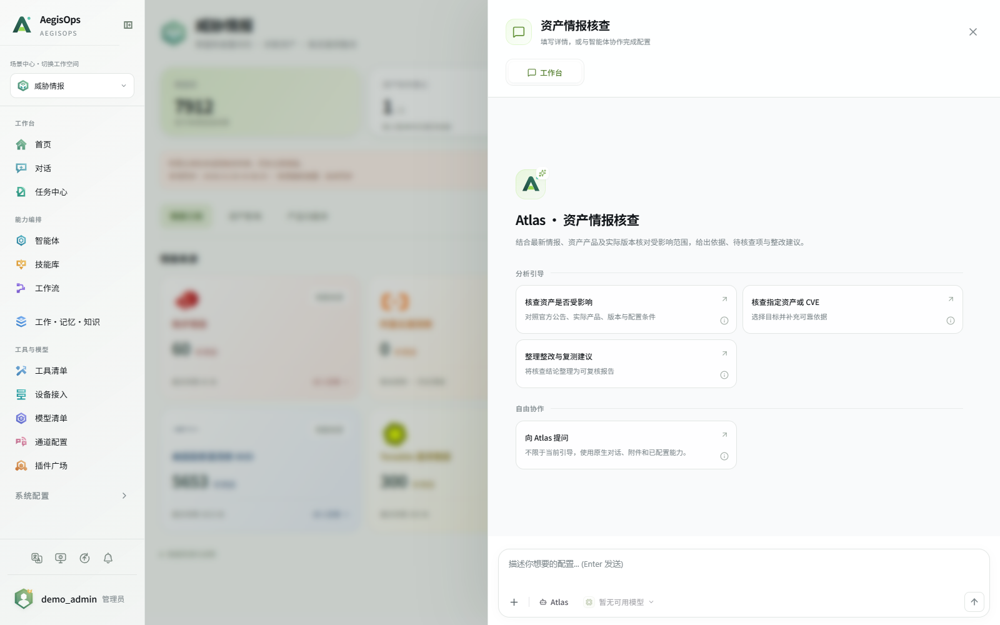
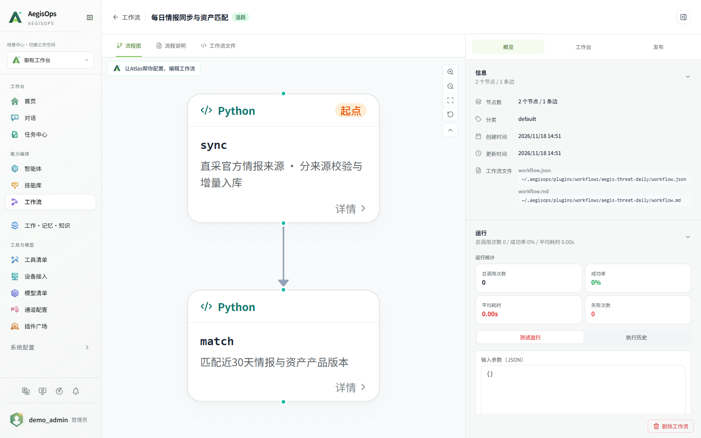

## 下载哪个版本

Release 保持三个主包，另外提供 SHA-256 校验清单：

| 下载 | 适用环境 | 使用方式 |
| --- | --- | --- |
| [Windows x64](https://github.com/knot07/AegisOps/releases/download/v2026.11.18/AegisOps-2026.11.18-Windows-x64.zip) | Windows 10/11 x64 | 解压到可写目录，双击 `start.cmd`；首次需联网下载主要依赖，完成后复用本地环境 |
| [Linux](https://github.com/knot07/AegisOps/releases/download/v2026.11.18/AegisOps-2026.11.18-Linux.zip) | Linux / WSL2 / Docker | `bash install.sh`，或按部署手册启动 Docker Compose |
| [源码](https://github.com/knot07/AegisOps/releases/download/v2026.11.18/AegisOps-2026.11.18-Source.zip) | 二次开发与自定义构建 | 包含源码、已构建前端、插件与部署脚本 |

Linux 与源码包使用同一套核心文件。主包均不包含 REA、Ghidra 或 JDK 离线环境。Windows 保留基础 Python、Git 和微软运行库安装器，其余主要依赖首次自动安装到项目私有目录，不改动系统 Python。

**首次部署自行设置管理员账号和密码，没有默认口令。** 发行包不带聊天记录、业务数据库、API 密钥或设备登录凭据。模型、设备和主机连接由部署者自行配置。已有用户更新前备份 `runtime` 数据目录；在线更新保留原有数据及配置。

## 页面导览

以下均为 2026.11.18 重新拍摄的页面；展开可查看各功能模块。

<b>工作台首页</b> — 运营趋势与常用功能入口。

<b>原生对话</b> — 通过 Atlas、模型、技能和工具协作；保留标准与 Super-agent 两种调度模式。

<b>任务中心</b> — 查看执行记录、工作流任务和定时计划。

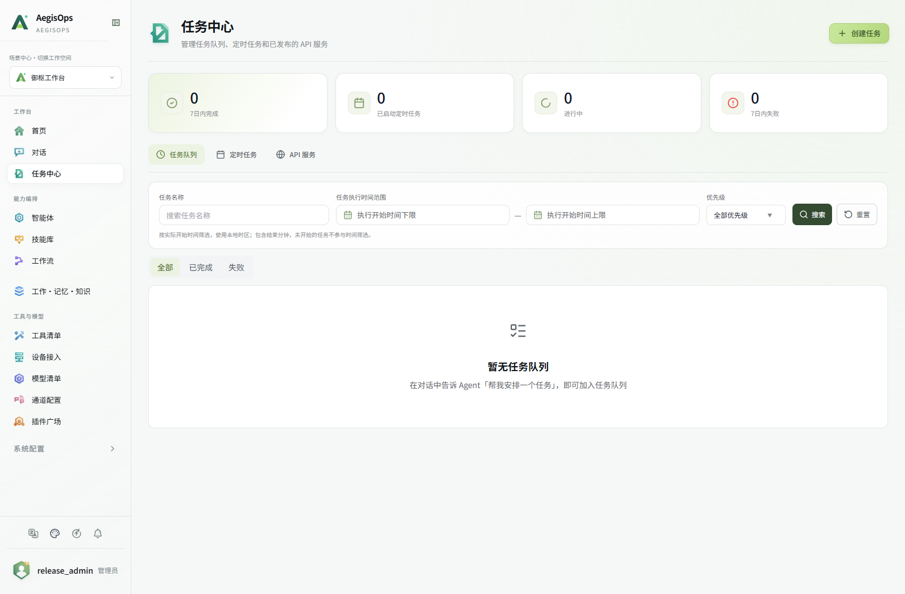

<b>智能体</b> — 管理各类智能体、角色、模型与已加载能力。

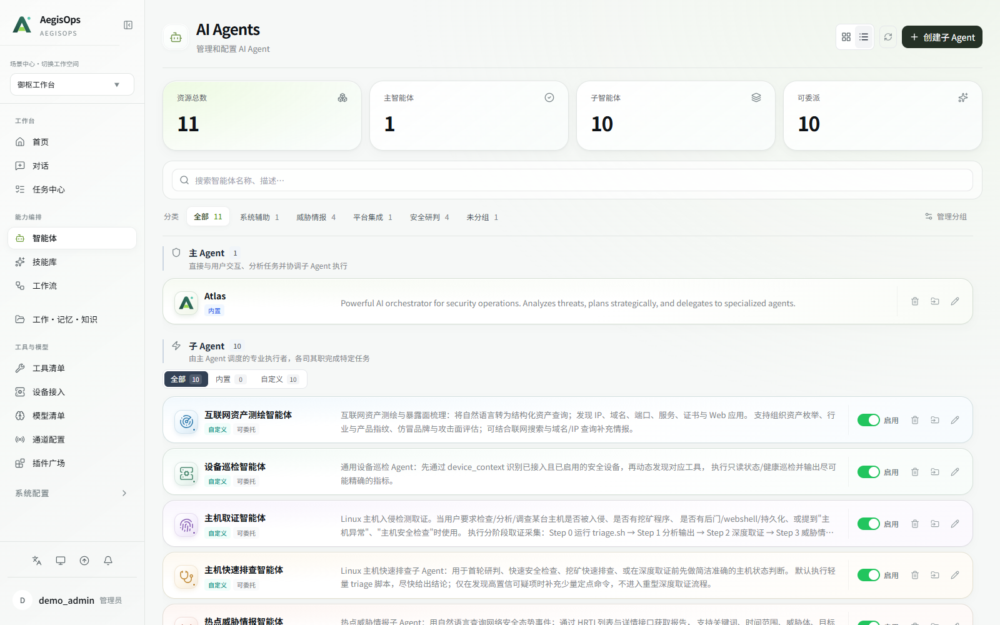

<b>技能库</b> — 按场景组织技能，厂商技能采用对应品牌图标。

<b>工作流</b> — 将重复步骤固化为可查看、编辑、发布和调度的流程。

<b>工作目录</b> — 浏览与管理工作文件。

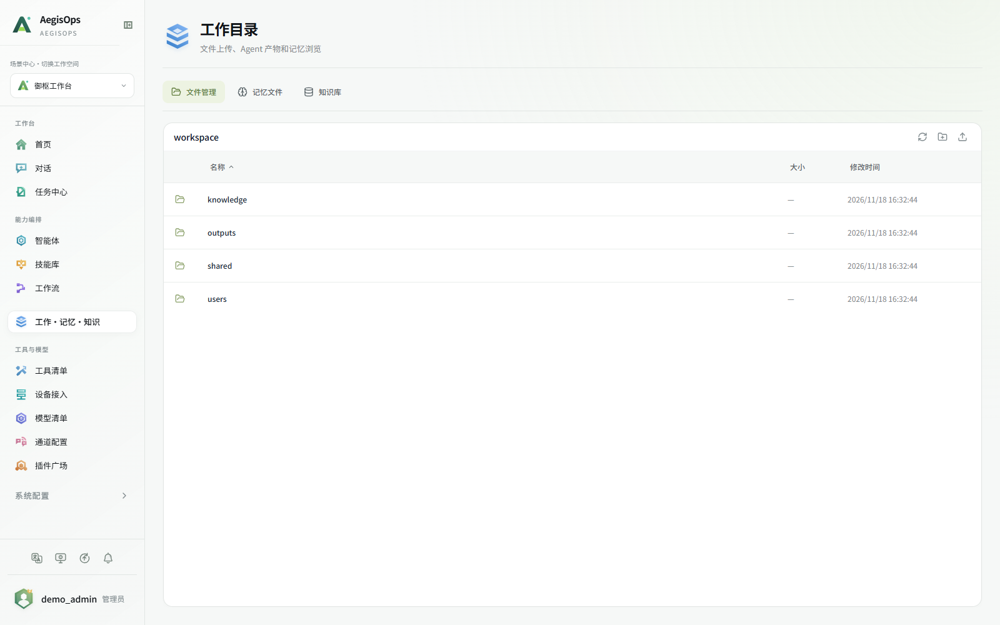

<b>知识库</b> — 管理知识数据与资料检索。

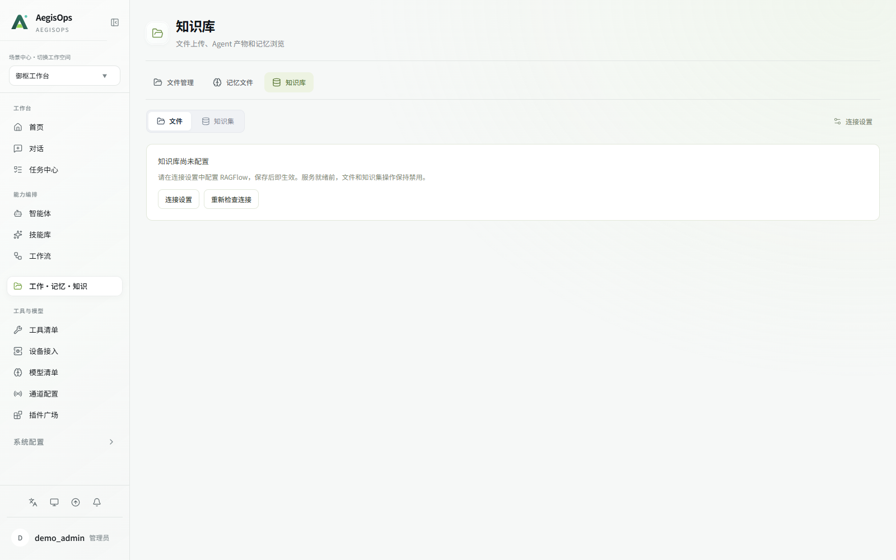

<b>记忆</b> — 管理持续协作中保存的记忆；与工作目录、知识库统一入口。

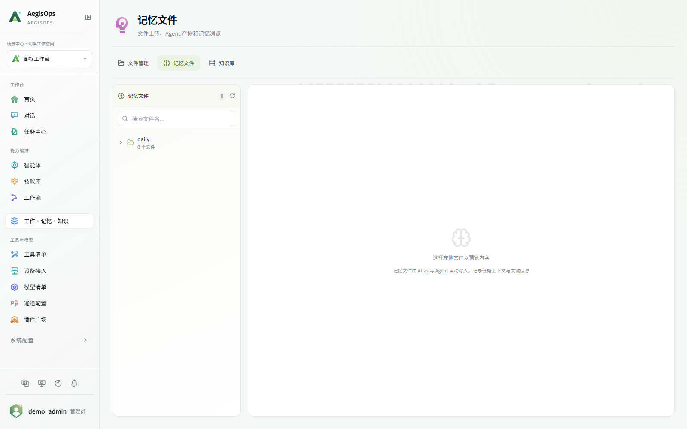

<b>工具清单</b> — 查看 API、设备、取证、逆向和资产情报核查等能力。

<b>设备接入</b> — 手动配置或由 Atlas 结合配置手册与样本协助接入。

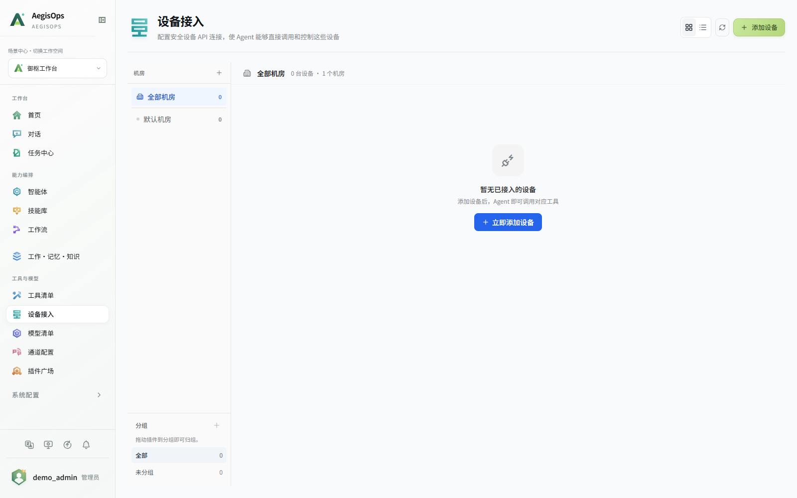

<b>模型清单</b> — 配置模型供应商、可用模型、默认模型及用量。

<b>通道配置</b> — 将原生会话接入已支持的消息通道。

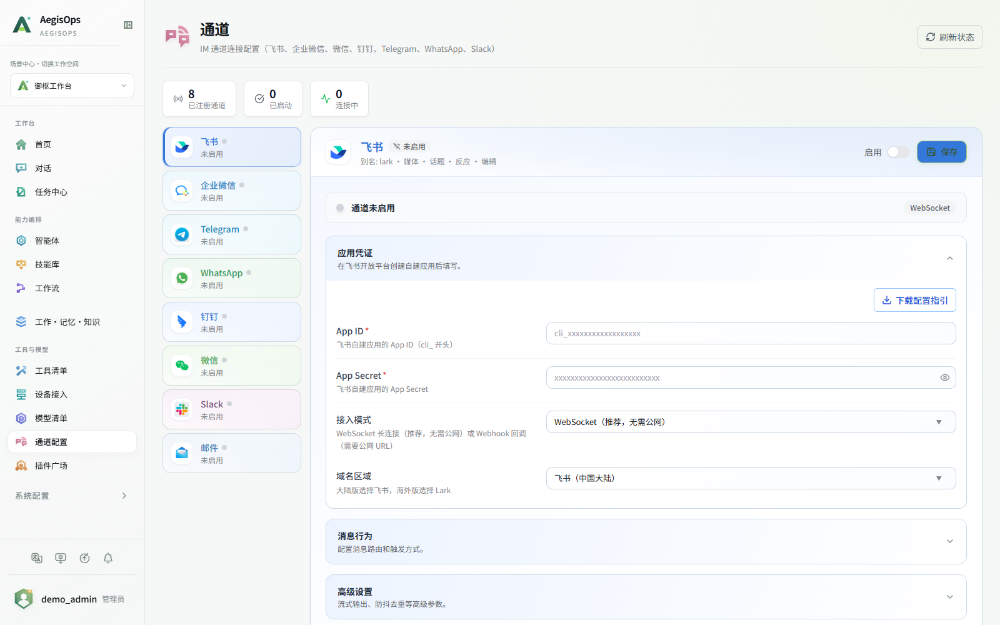

<b>插件广场</b> — 统一管理场景、技能及工具插件；厂商项目使用品牌图标。

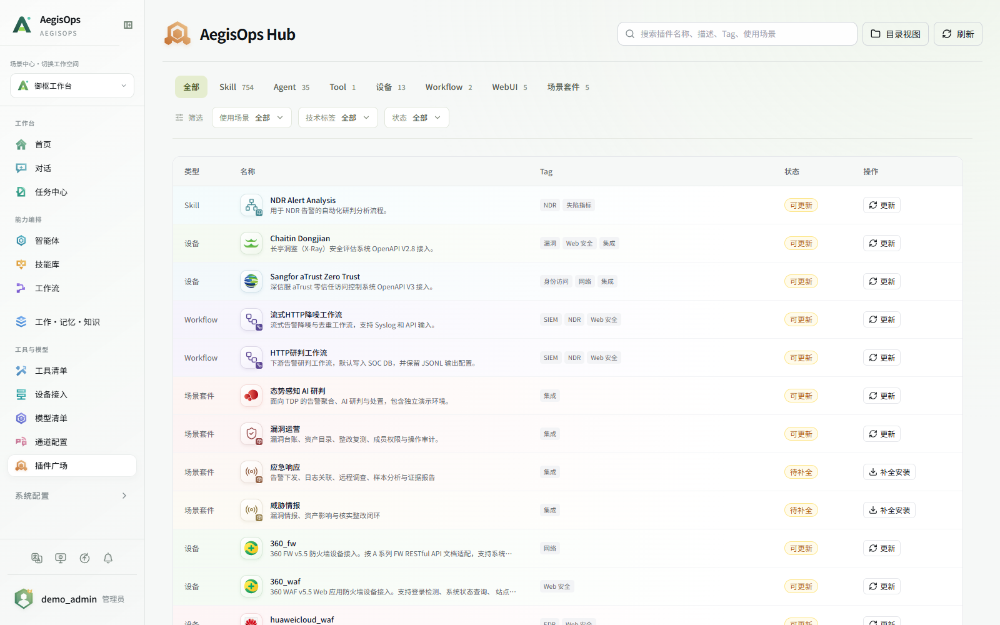

<b>账号管理</b> — 管理平台成员及场景权限，配置在线更新。

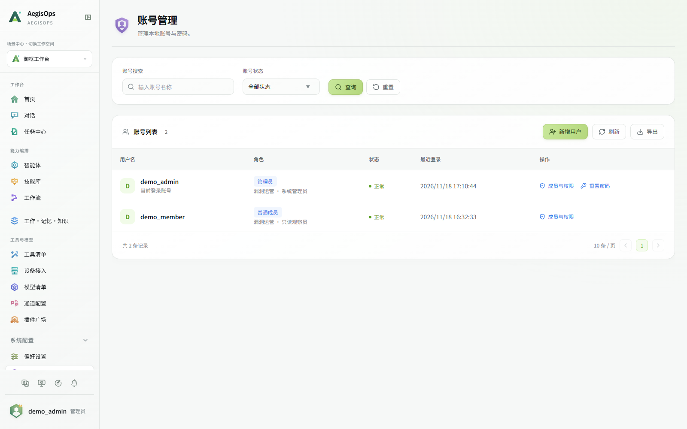

<b>偏好设置</b> — 调整工作台的个人使用偏好。

<b>系统日志</b> — 检查运行记录与故障线索。

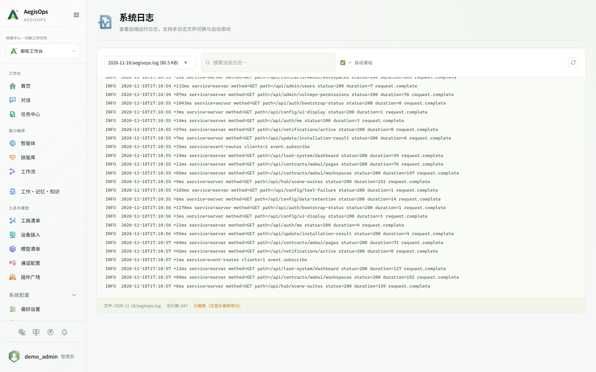

<b>归档记录</b> — 查看已归档内容。

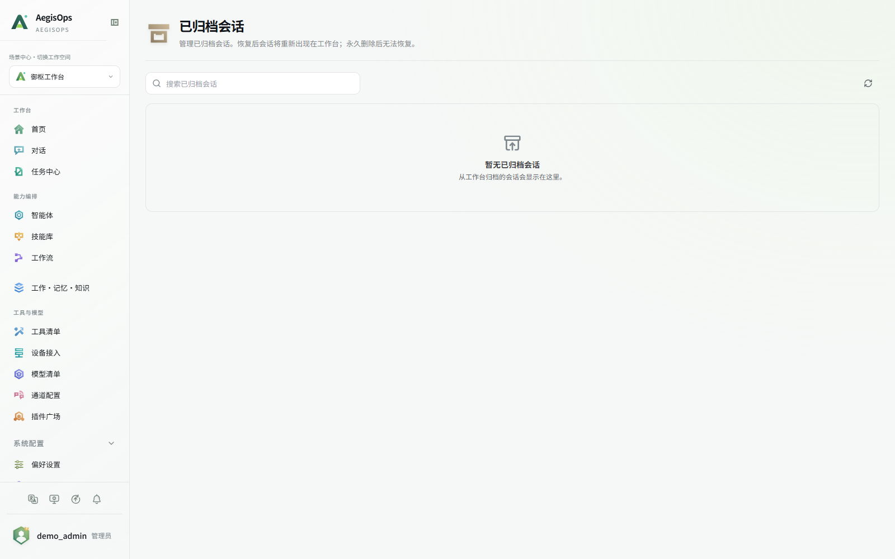

## 使用中的几个关键点

- AI 输出需要结合原始证据复核。情报命中不等于漏洞存在，缺少版本或配置时不能直接确认。
- 远程调查只面向已登记且授权的目标；样本外发使用明确确认，不在发行包中保存第三方网页登录态。
- 默认关闭每日自动更新，启用后由任务中心执行；平台需要在计划时间保持运行。
- 第三方情报、工具与厂商图标归各自权利人所有。采集协议研究参考 [Threat-Broadcast-Plus](https://github.com/Aabyss-Team/Threat-Broadcast-Plus)，本平台不下载其公开数据库。Solar 来自[官方取证工具](https://www.solarert.com/forensics)，REA 来自 [morluto/rea](https://github.com/morluto/rea)。

[部署与操作手册](DEPLOY.md) · [Windows 指南](WINDOWS.md) · [在线更新](docs/ONLINE-UPDATE.md) · [发行验证](docs/RELEASE-VERIFICATION.md)
