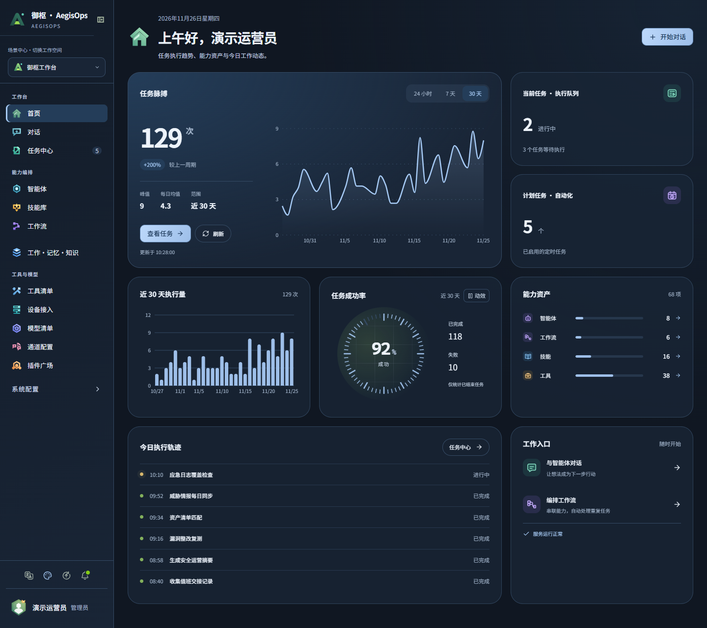
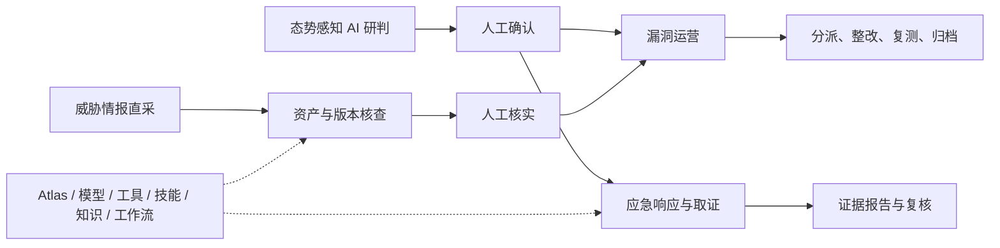
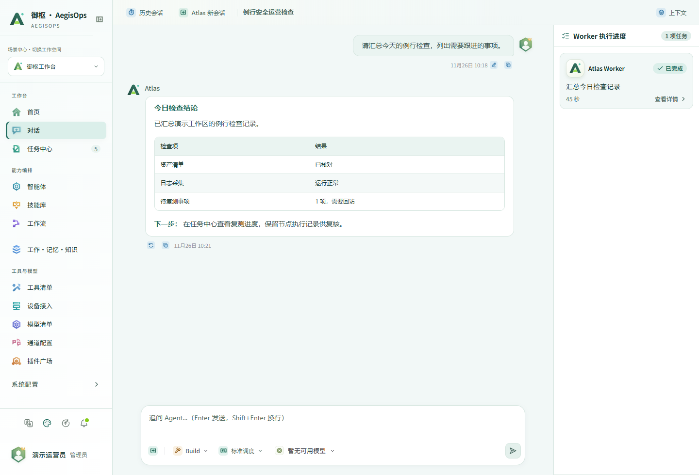
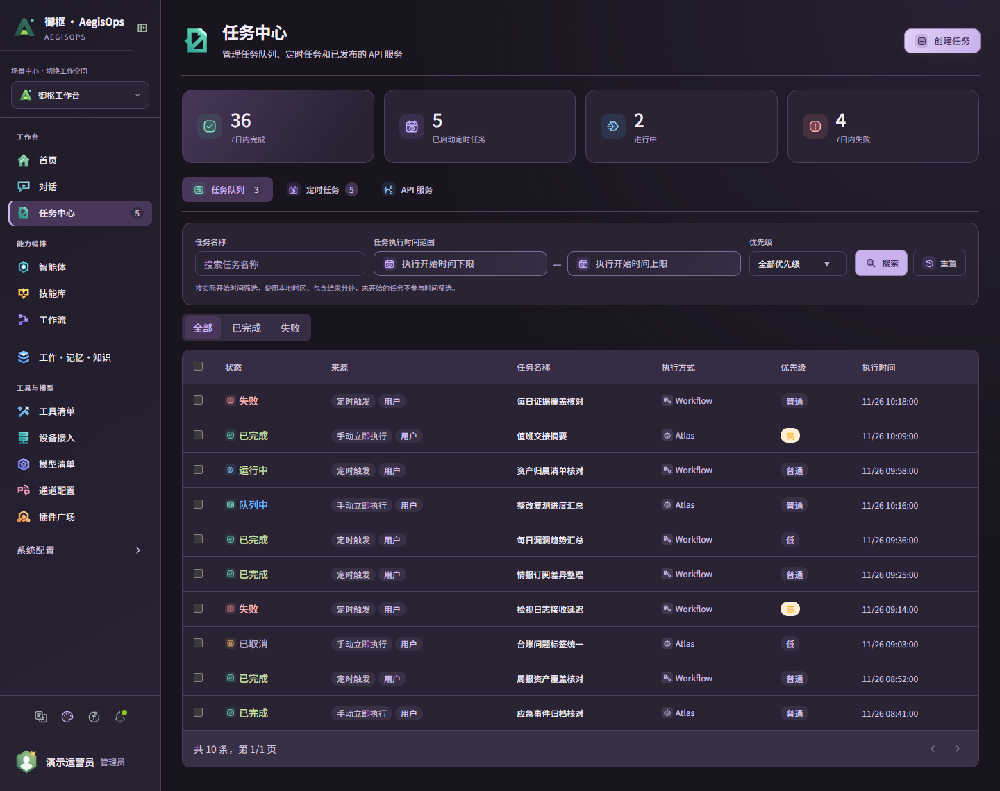
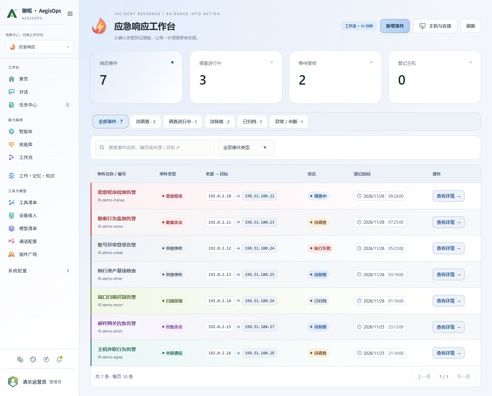
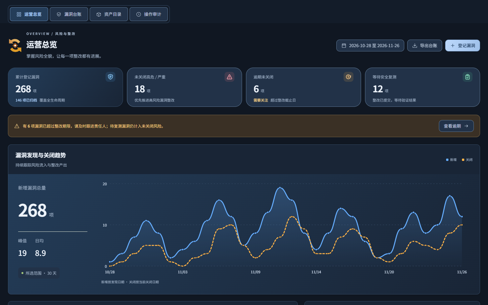

# 御枢 · AegisOps

### 让情报关联资产，让告警进入处置，让结论回到证据。

一套连接模型、智能体、工作流与安全运营场景的开源工作台。

[下载部署](https://github.com/knot07/AegisOps/releases/latest) · [部署与操作](DEPLOY.md) · [Windows 安装](WINDOWS.md) · [本次更新](docs/CHANGELOG-2026.11.26.md) · [页面导览](#页面导览)

## 2026.11.26：日期联动与深色体验修复

漏洞运营趋势图按所选日期刷新完整范围，支持曲线入场动效；首页执行量与时间筛选同步。应急响应优先打开事件台账，任务列表和报告空状态适配浅色、深色主题。详见[更新说明](docs/CHANGELOG-2026.11.26.md)与[当前版界面截图](docs/SCREENSHOTS-2026.11.26.md)。

## 2026.11.25：任务记录与工作台交互升级

任务中心可以追踪工作流的节点执行，Worker 进度与结果在对话旁可见。工作台更新了消息卡片、状态动画、主题对比度和操作图标。详见[该版更新说明](docs/CHANGELOG-2026.11.25.md)。

## 2026.11.19：统一主题，完善日常操作

新增 **海盐蓝、青岚、暮紫、暖砂** 四款皮肤，连同经典森绿均支持浅色、深色与跟随系统。统一工作台与业务场景的卡片、按钮、日期筛选和文字层级，同时保留厂商标识与风险状态的含义。

| 本次更新 | 实际变化 |
| --- | --- |
| 五套主题皮肤 | 侧栏调色盘或偏好设置随时切换，自动保存，业务场景同步生效 |
| 深色界面重做 | 修复配置抽屉、模型管理、工具详情与弹窗中的白底和低对比度 |
| 模型配置完善 | 品牌化编辑界面、上下文刻度、完整模型名称和当前思考强度 |
| 研判图表保留 | 只更换汇总卡和趋势区背景，坐标及图表配色保持原样 |
| 运行问题修复 | 工具刷新不再重复注册场景路由，发行包移除旧默认定时任务 |

此前版本已包含威胁情报官方直采、Atlas 资产核查、Solar 辅助取证及按需安装 REA，详见[上一版更新](docs/CHANGELOG-2026.11.18.md)。

## 四个工作空间，贯通日常运营

### 态势感知 AI 研判

从设备告警进入研判，保留来源设备与原始线索。确认攻击后，可将事件转入应急响应，或将漏洞转入漏洞库。演示环境与正式接入分别保留；非预置设备需按真实 API 和日志样本适配，不能仅修改名称后视为接入完成。

### 漏洞运营

统一资产目录与漏洞台账，支持搜索、编辑、删除、资产关联、整改分派、提交复测和历史归档。管理员同样可以完成复测。资产拓扑与趋势帮助查看业务关联，Atlas 可协作整理录入资料。

### 应急响应

事件接收 → 来源设备日志关联 → 授权主机排查 → 文件取证与分析 → 证据报告 → 人工复核。Linux 支持 SSH，Windows 支持 WinRM HTTPS。AI 根据实际证据继续追查，报告引用证据编号，不将建议写成已执行动作。

Solar 作为调查背后的辅助工具使用。Linux 采集受主机登记、指纹、权限、超时及尺寸限制约束；失败会留下记录并继续使用已有证据。Windows 使用固定 WinRM 模板，当前不宣称能后台执行 Solar 的图形工具。

样本支持静态初筛、可选 REA/Ghidra 静态逆向、微步与 VirusTotal 查询或明确确认后的上传。REA 环境按需安装，使用 Linux/WSL2 工作环境；不提供运行恶意样本的动态沙箱，也不把字符串匹配称为深度逆向。

### 威胁情报

首页仅展示七个来源入口：微步、阿里云、斗象、长亭、NVD、Tenable、CISA。进入来源后查看具体公告，按日期、等级或关键词筛选，保留原文链接和模型辅助中文译文。采集遵循公开接口或官方订阅，来源限制会如实显示，不伪造更新成功。

Atlas 的这个入口专门用于**核查已有资产是否受情报漏洞影响**，不再默认打开资产创建引导。它可只读获取资产产品、版本、公告与候选关联，结合证据区分已确认、可能受影响、已排除及资料不足。产品名命中只能产生线索；人工核实后才进入漏洞整改。

## 下载哪个版本

Release 保持三个主包，另外提供 SHA-256 校验清单：

| 下载 | 适用环境 | 使用方式 |
| --- | --- | --- |
| [Windows x64](https://github.com/knot07/AegisOps/releases/download/v2026.11.26/AegisOps-2026.11.26-Windows-x64.zip) | Windows 10/11 x64 | 解压到可写目录，双击 `start.cmd`；首次需联网下载主要依赖，完成后复用本地环境 |
| [Linux](https://github.com/knot07/AegisOps/releases/download/v2026.11.26/AegisOps-2026.11.26-Linux.zip) | Linux / WSL2 / Docker | `bash install.sh`，或按部署手册启动 Docker Compose |
| [源码](https://github.com/knot07/AegisOps/releases/download/v2026.11.26/AegisOps-2026.11.26-Source.zip) | 二次开发与自定义构建 | 包含源码、已构建前端、插件与部署脚本 |

Linux 与源码包使用同一套核心文件。主包均不包含 REA、Ghidra 或 JDK 离线环境。Windows 保留基础 Python、Git 和微软运行库安装器，其余主要依赖首次自动安装到项目私有目录，不改动系统 Python。

**首次部署自行设置管理员账号和密码，没有默认口令。** 发行包不带聊天记录、业务数据库、API 密钥或设备登录凭据。模型、设备和主机连接由部署者自行配置。已有用户更新前备份 `runtime` 数据目录；在线更新保留原有数据及配置。

## 页面导览

以下截图来自 **2026.11.26** 发行界面，使用模拟数据。[查看完整截图集（含登录页、Worker 和节点详情）](docs/SCREENSHOTS-2026.11.26.md)。

### Atlas 对话与 Worker

对话按消息卡片展示；右侧可查看 Worker 的执行状态和结果。

### 任务中心

按任务名称、执行时间和优先级筛选记录。点击工作流任务可展开节点执行记录，定位失败节点。

### 应急响应事件台账

按事件类型与状态浏览记录，点击详情进入该事件的调查工作台。

### 漏洞运营趋势

选择近 30 天后，新增与关闭曲线、日期轴和统计摘要同步刷新。

## 使用中的几个关键点

- AI 输出需要结合原始证据复核。情报命中不等于漏洞存在，缺少版本或配置时不能直接确认。
- 远程调查只面向已登记且授权的目标；样本外发使用明确确认，不在发行包中保存第三方网页登录态。
- 默认关闭每日自动更新，启用后由任务中心执行；平台需要在计划时间保持运行。
- 第三方情报、工具与厂商图标归各自权利人所有。采集协议研究参考 [Threat-Broadcast-Plus](https://github.com/Aabyss-Team/Threat-Broadcast-Plus)，本平台不下载其公开数据库。Solar 来自[官方取证工具](https://www.solarert.com/forensics)，REA 来自 [morluto/rea](https://github.com/morluto/rea)。

[部署与操作手册](DEPLOY.md) · [Windows 指南](WINDOWS.md) · [在线更新](docs/ONLINE-UPDATE.md) · [发行验证](docs/RELEASE-VERIFICATION.md)
