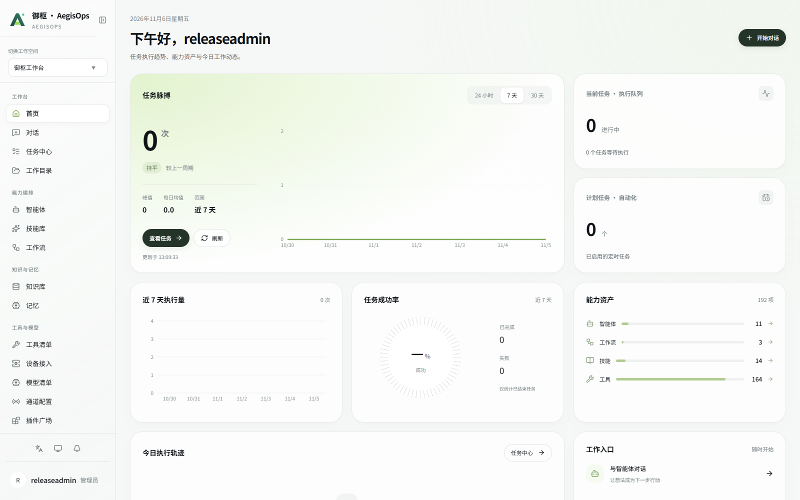
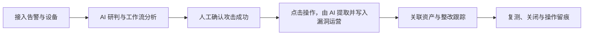
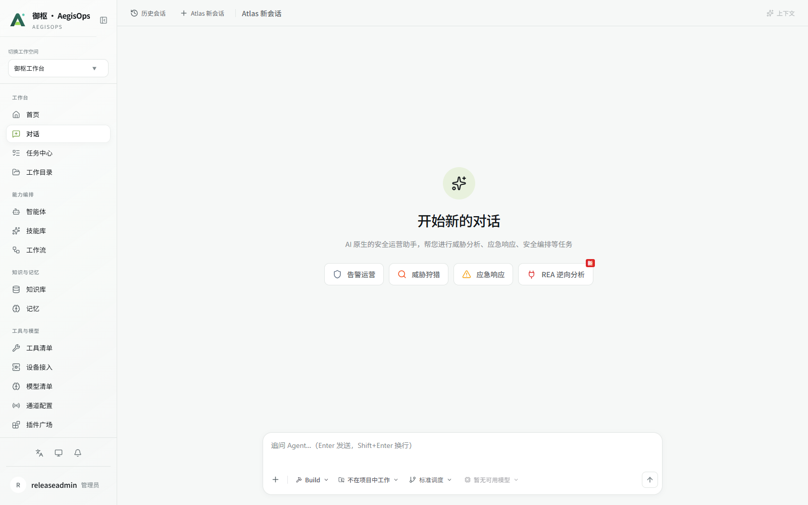
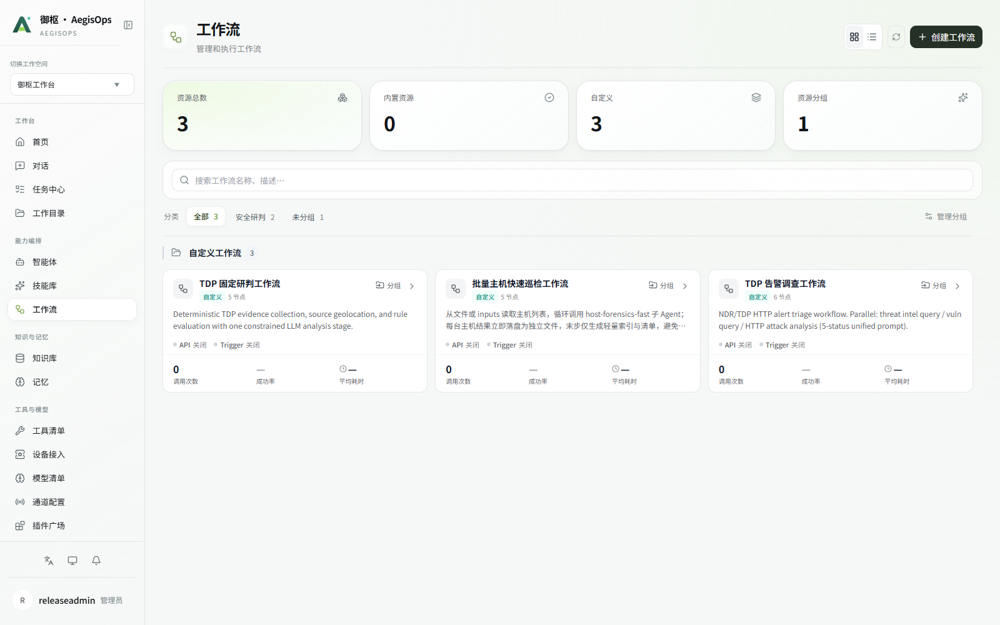
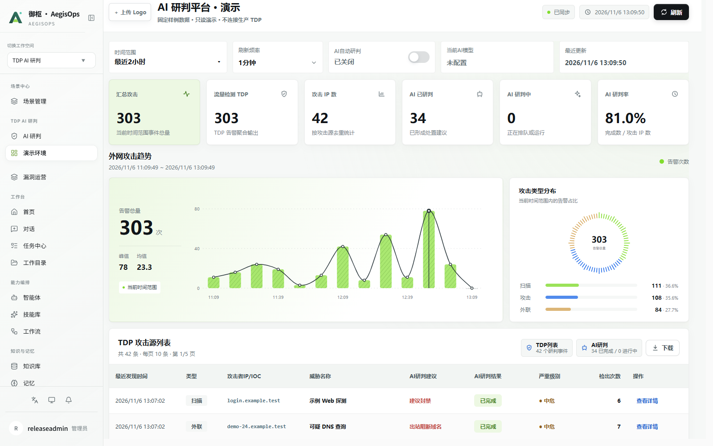
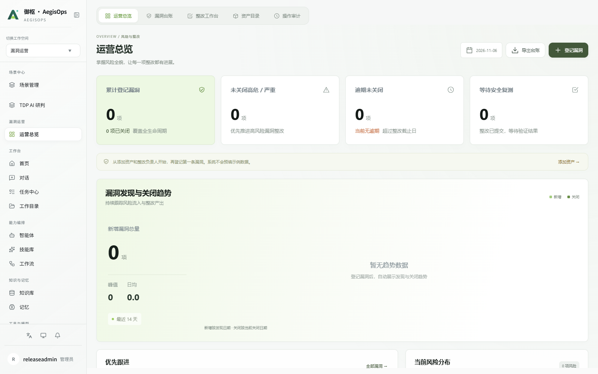
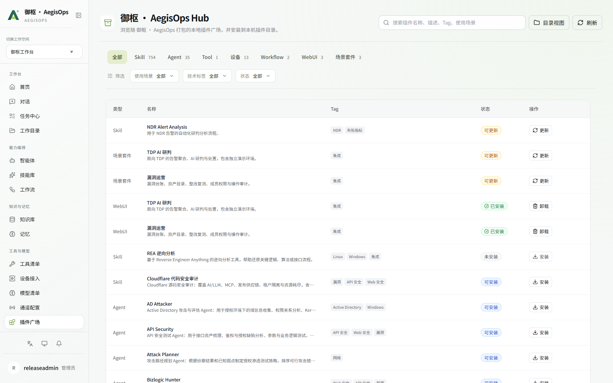
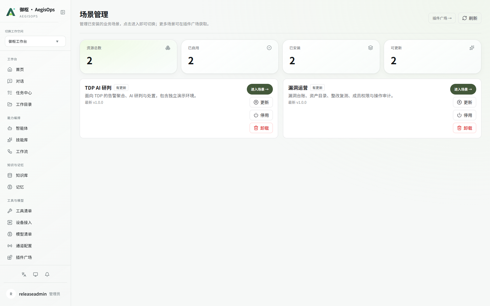

<div align="center">


# 御枢 · AegisOps

### 让研判有依据，让处置有流程，让整改有跟踪。

以 AI 对话连接智能体、工具、知识与工作流的安全运营工作台。

[](LICENSE.txt)
[](pyproject.toml)
[](webui/package.json)
[](https://github.com/knot07/AegisOps/releases/latest)

[功能介绍](#功能一览) · [界面预览](#界面预览) · [快速部署](#快速部署) · [操作手册](DEPLOY.md) · [下载发行版](https://github.com/knot07/AegisOps/releases/latest)

</div>



## 项目介绍

安全运营中的一次告警，往往需要在设备平台、分析工具、知识文档和漏洞台账之间反复切换。AegisOps 将这些工作放进同一个工作台：从对话发起任务，通过智能体与工作流完成分析，再把确认的问题带入漏洞运营，继续跟进资产、整改和复测。

项目内置 **TDP AI 研判** 与 **漏洞运营** 两个业务场景，同时提供任务中心、插件广场、模型管理和统一用户权限。可以先使用对话与现有工作流，再按实际业务接入模型、设备和工具。

### 一条完整的运营路径



研判和写入需要配置可用模型及设备连接。AI 生成内容可在漏洞运营中核对、补充，最终业务判断仍由操作人员确认。

## 功能一览

| 模块 | 主要功能 | 解决的问题 |
| --- | --- | --- |
| 智能对话 | Atlas 对话入口、模型与 Agent 选择、历史会话、上下文管理 | 从自然语言任务进入分析与执行 |
| Agent 调度 | 普通调度与实验性 Super-agent 调度，在输入区切换 | 根据任务需要选择调度方式 |
| 任务与工作流 | 任务查看、工作流创建与预览、内置研判流程 | 将重复的分析步骤组织为可复用流程 |
| TDP AI 研判 | 告警查看、AI 辅助研判、独立演示页面、人工确认后写入漏洞运营 | 衔接告警分析与后续处置 |
| 漏洞运营 | 运营总览、漏洞台账、整改工作台、资产目录、操作审计 | 持续跟踪漏洞整改与复测 |
| 资产目录 | 搜索、新增、编辑、删除；关联漏洞时提供删除保护 | 维护漏洞与资产之间的关系 |
| 知识与记忆 | 工作目录、知识库、记忆 | 为任务提供文件与知识上下文 |
| 插件与场景 | 插件搜索与筛选、资源安装、两个场景切换 | 按业务需要扩展能力与界面 |
| 模型与连接 | 模型配置与用量、设备接入、消息通道配置 | 统一管理外部能力连接 |
| 账号与权限 | 创建用户、主系统登录、系统角色、漏洞运营访问与业务角色 | 在主系统统一维护成员权限 |

**Super-agent 当前为实验性能力。** 普通调度继续保留，建议先用范围明确的小任务评估效果，再决定如何使用。

## 界面预览

以下截图来自独立的干净演示环境。主系统与漏洞运营使用空业务数据；告警研判截图来自标明“演示环境”的页面。实际统计随任务执行和业务录入变化。

### 对话工作台

历史会话、模型选择、执行模式和调度入口集成在对话界面，减少任务执行时的页面跳转。截图环境未配置模型，实际使用前需在模型清单完成配置。



### 工作流编排

在同一入口管理工作流、查看流程详情并创建新流程。发行版包含 `datang-tdp-fixed-review` 研判工作流；设备凭据与模型参数由部署者重新配置。



### 告警研判

通过业务场景查看告警、研判结果与关联信息。人工确认攻击成功后，可触发 AI 提取告警中的漏洞信息并写入漏洞运营，继续跟踪后续整改。



### 漏洞运营

以运营总览为入口，通过顶部标签切换漏洞台账、整改工作台、资产目录和操作审计。成员与权限在主系统统一维护。



### 插件广场

按资源类型浏览，结合搜索、使用场景、技术标签和安装状态筛选插件。智能体、技能、工具、工作流及场景资源在统一目录中管理。



<details>
<summary><strong>查看场景管理截图</strong></summary>

两个业务场景可从场景管理进入，也可以通过工作空间入口切换。



</details>

## 快速部署

只需按用途选择一个包，手册和校验清单已包含在包内：

| 用途 | 下载 | 开始使用 |
| --- | --- | --- |
| Linux 部署 | [Linux.zip](https://github.com/knot07/AegisOps/releases/download/v2026.11.06/AegisOps-2026.11.06-Linux.zip) | 解压后阅读 `README.md`，执行 `bash install.sh` |
| Windows 使用 | [Windows-x64.zip](https://github.com/knot07/AegisOps/releases/download/v2026.11.06/AegisOps-2026.11.06-Windows-x64.zip) | 完整解压后双击 `start.cmd` |
| 二次开发 | [Source.zip](https://github.com/knot07/AegisOps/releases/download/v2026.11.06/AegisOps-2026.11.06-Source.zip) | 完整源码，需要安装依赖并构建 |

### Windows 便携版

Windows 10 / 11 x64 用户选择上表的 **Windows-x64.zip**，完整解压后双击 `start.cmd`。包内提供 Python、Node、Git for Windows、依赖和前端，启动基础服务无需额外安装 Docker、WSL 或开发环境。

如果电脑缺少 Microsoft Visual C++ x64 运行库，按提示运行包内的微软官方安装程序。首次打开系统后自行设置管理员，再配置自己的模型和设备连接。完整说明见 [Windows 部署手册](WINDOWS.md)，实际测试范围见包内验证记录。

### 方式一：Docker Compose

准备 Docker Engine 与 Compose v2；Windows 可使用 Docker Desktop 的 Linux 容器模式。

```sh
git clone https://github.com/knot07/AegisOps.git
cd AegisOps
docker compose up -d --build
```

浏览器访问 **http://127.0.0.1:5200**，首次进入时自行设置管理员账号和密码，系统没有预置账号。

默认只向本机开放。局域网访问、端口调整、数据卷及备份方式见 [部署与操作手册](DEPLOY.md)。

### 方式二：Linux / WSL 原生部署

准备 Python **3.12**、Node.js **22**、npm、Git 及 Python venv。

```sh
git clone https://github.com/knot07/AegisOps.git
cd AegisOps
bash install.sh
.venv/bin/python run.py --host 127.0.0.1 --port 5200
```

可通过 `--data-dir /your/data/path` 指定持久化数据目录。WSL 建议将项目放在 Linux 文件系统内。

### 方式三：下载部署包

到 [Releases](https://github.com/knot07/AegisOps/releases/latest) 下载干净部署包并解压，按随附手册部署。部署包包含已构建的主界面；从源码构建时会生成前端资源。

Linux 安装与源码构建需要联网下载依赖或基础镜像。Windows 便携包已提供运行时及依赖；外部模型和设备功能仍需要相应连接。

## 首次使用

1. **创建管理员**：打开系统，设置自己的账号和密码。
2. **配置模型**：在模型清单填写接口、模型标识和密钥，测试连接并设置默认模型。
3. **接入设备**：配置实际设备地址与认证信息，再运行相关研判流程。
4. **确认场景**：打开场景管理，检查告警研判与漏洞运营是否可进入。
5. **创建成员**：在账号管理新增用户，并分配系统角色和漏洞运营权限。
6. **验证流程**：用测试告警验证研判与写入，在漏洞运营中核对结果，再验证整改操作和数据持久化。

## 数据与部署说明

- **干净交付**：不含现有用户、密码、聊天记录、漏洞、资产、模型密钥或设备凭据。
- **持久化**：Docker 使用命名数据卷；原生启动默认使用项目内 `runtime/`，也可指定独立目录。
- **备份**：停止服务后完整备份数据根目录，包含配置、数据库、工作文件、插件和隐藏文件。不要只复制数据库。
- **外部依赖**：AI、设备接口及消息渠道需要部署者提供有效连接和凭据。
- **操作手册**：部署、使用、备份、迁移与常见问题均在 [DEPLOY.md](DEPLOY.md)。

## 项目结构

```text
AegisOps/
├── aegisops/             # 后端服务、Agent、调度与业务接口
├── webui/               # Web 前端源码与公共资源
├── defaults/
│   ├── plugins/         # 内置插件、工作流与场景运行时
│   └── hub/             # 插件广场本地资源目录
├── tests/               # 后端测试
├── docs/images/         # 项目界面截图
├── run.py               # 服务启动与数据目录初始化
├── install.sh           # Linux / WSL 原生安装
├── Dockerfile
├── compose.yaml
└── DEPLOY.md            # 部署与操作手册
```

## 验证状态

已完成前端生产构建、独立空数据目录启动、首次管理员初始化与登录、权限接口检查、两个场景页面构建和研判工作流加载；账号初始化及调度相关后端测试 **20 项通过**。

原生验证复用了已有依赖。完整在线依赖安装及 Docker 镜像构建尚未实测，部署后请按手册中的验收流程检查。AI 研判效果取决于模型能力、连接配置与输入数据。

## 反馈与贡献

欢迎通过 [Issues](https://github.com/knot07/AegisOps/issues) 反馈问题或提出功能建议，通过 Pull Request 提交改进。反馈时请附复现步骤、版本和脱敏日志，不要提交真实密钥、设备凭据或业务数据。

## 许可证

项目使用 [Apache License 2.0](LICENSE.txt)。随附插件、技能及第三方资源的许可要求以各自目录中的声明为准。
