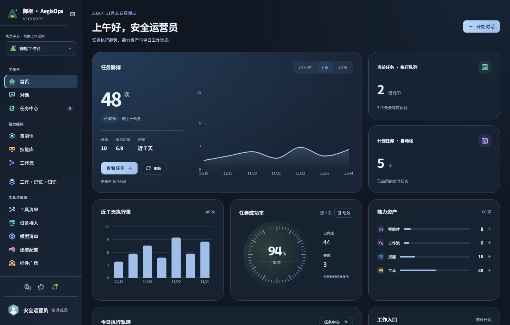
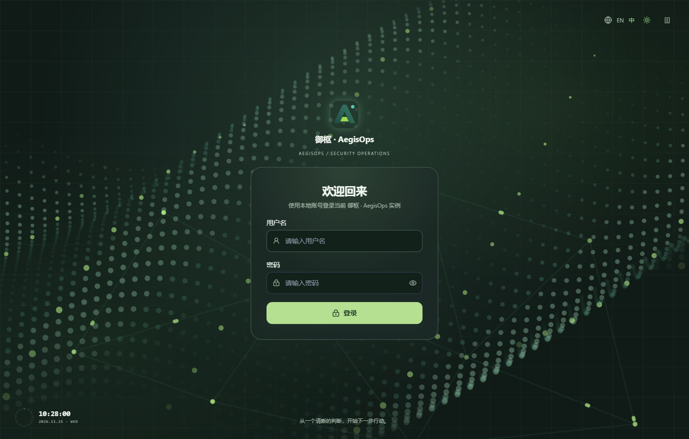
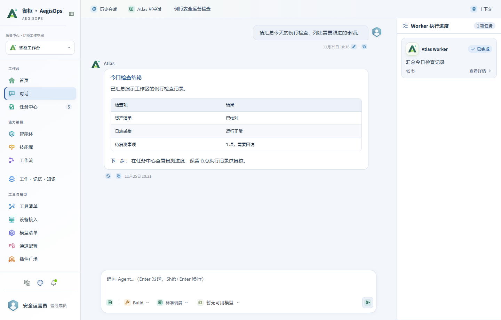
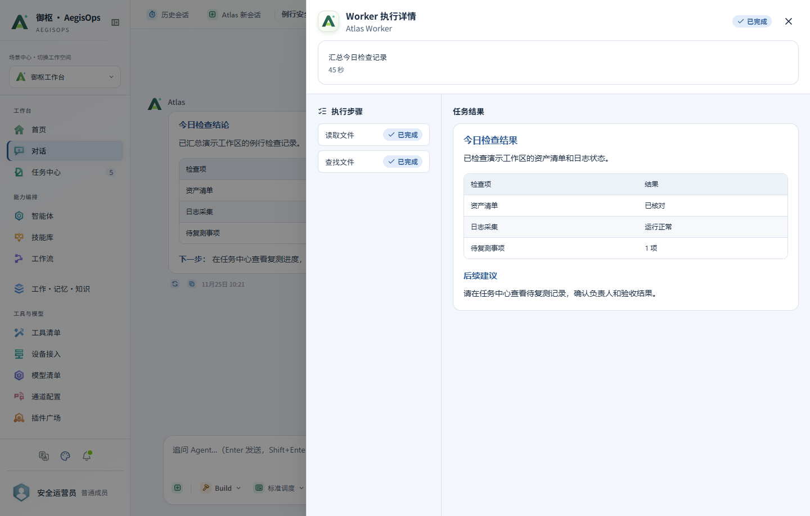
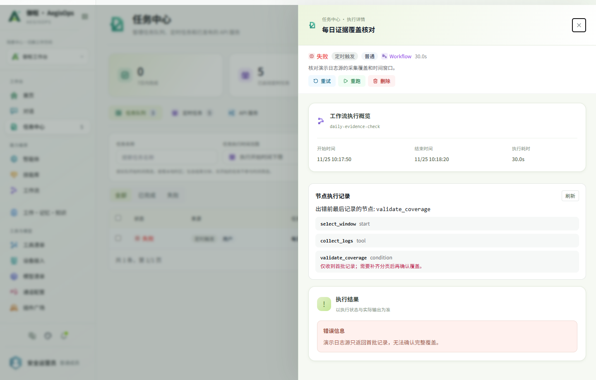
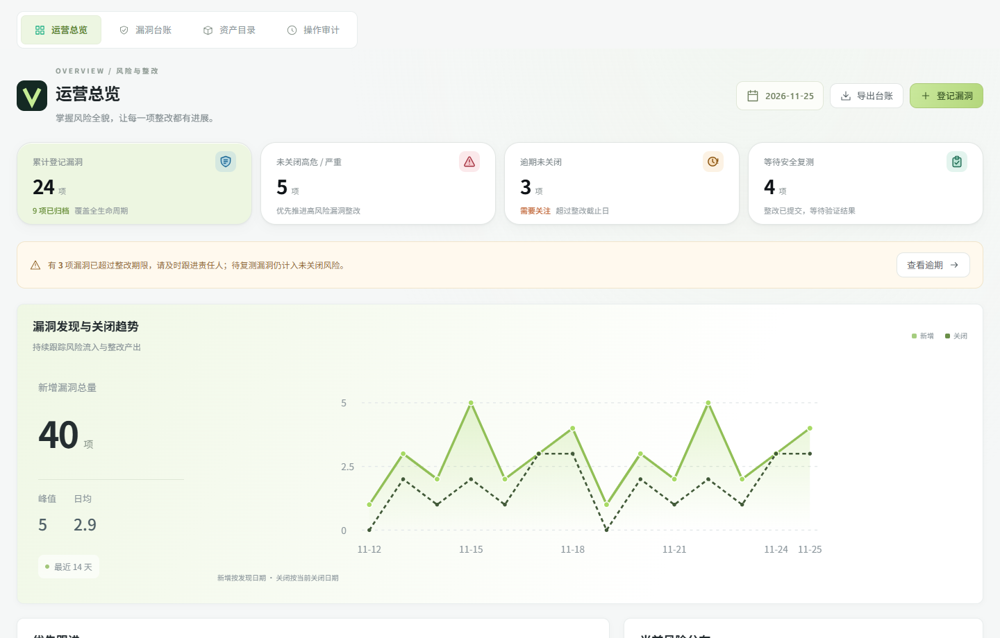

# 2026.11.25 界面截图

下列截图来自 Chrome 中运行的工作台，使用演示数据，不含真实会话或资产信息。

## 工作台首页

海盐蓝深色主题，展示任务趋势、成功率刻度表盘和能力资产。

## 登录页

流动背景、时钟和登录卡片。截图展示其中一帧。

## 对话与 Worker 进度

消息卡片与右侧 Worker 执行状态。

## Worker 执行详情

工具步骤与结果报告分栏展示。

## 工作流节点记录

从任务失败结果定位最后记录的节点和节点错误。

## 漏洞运营总览（发行后微调）

更新后的四张统计卡片为底部说明预留空间；此间距微调已进入主分支，未改动原发行包。

