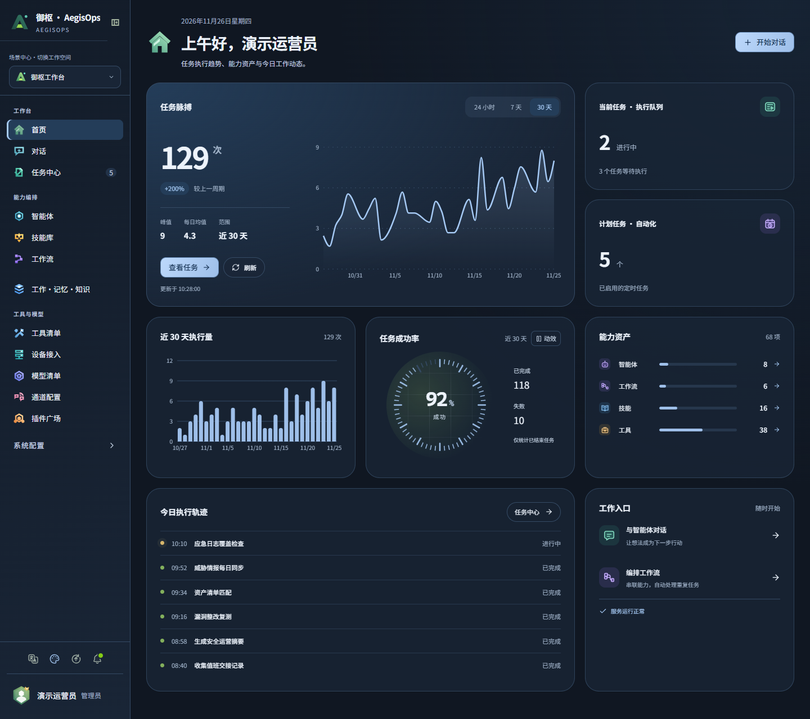
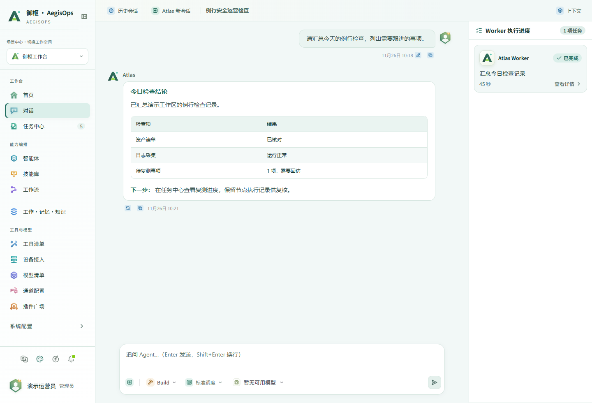
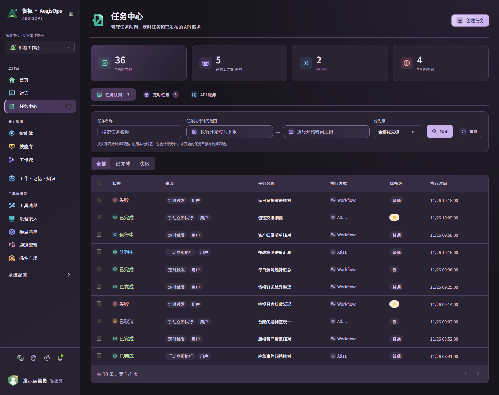
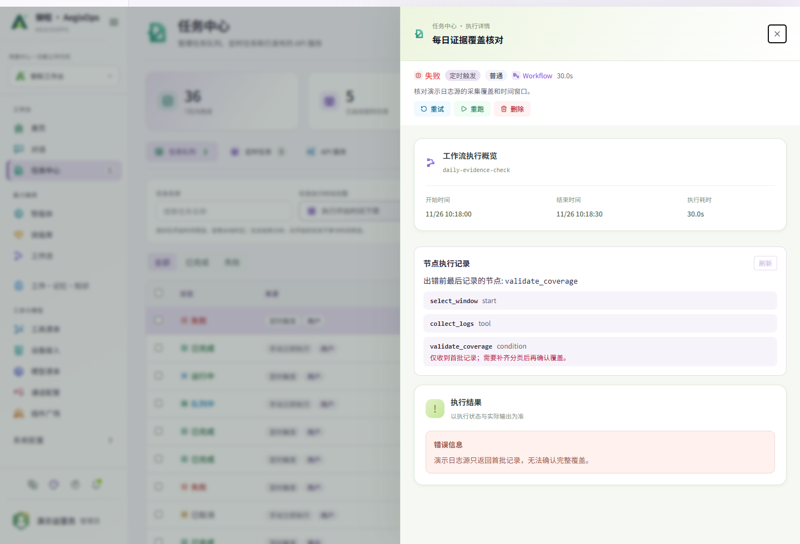
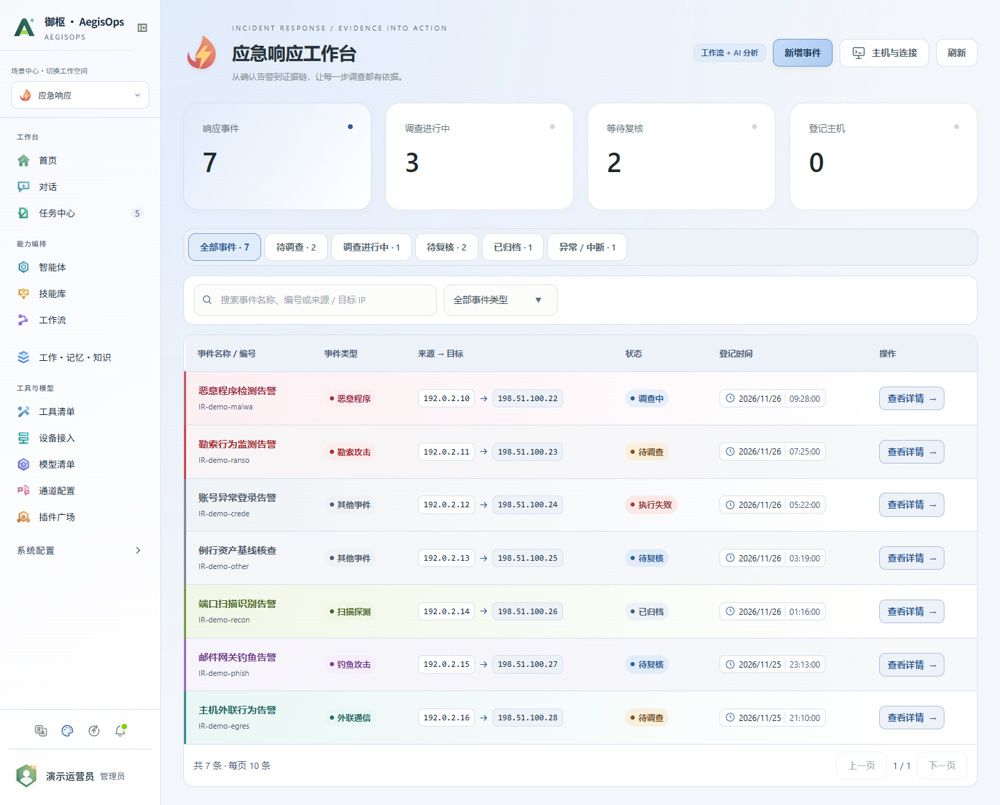
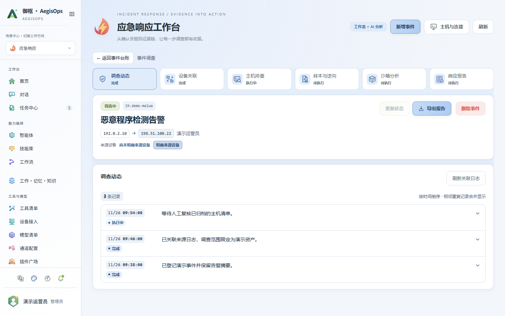
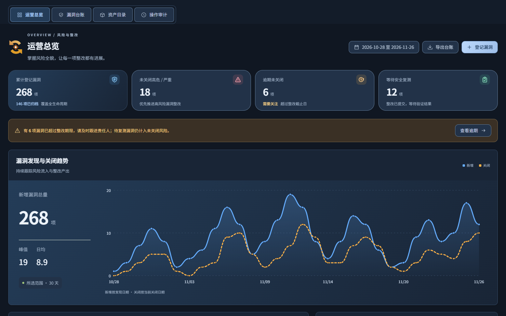
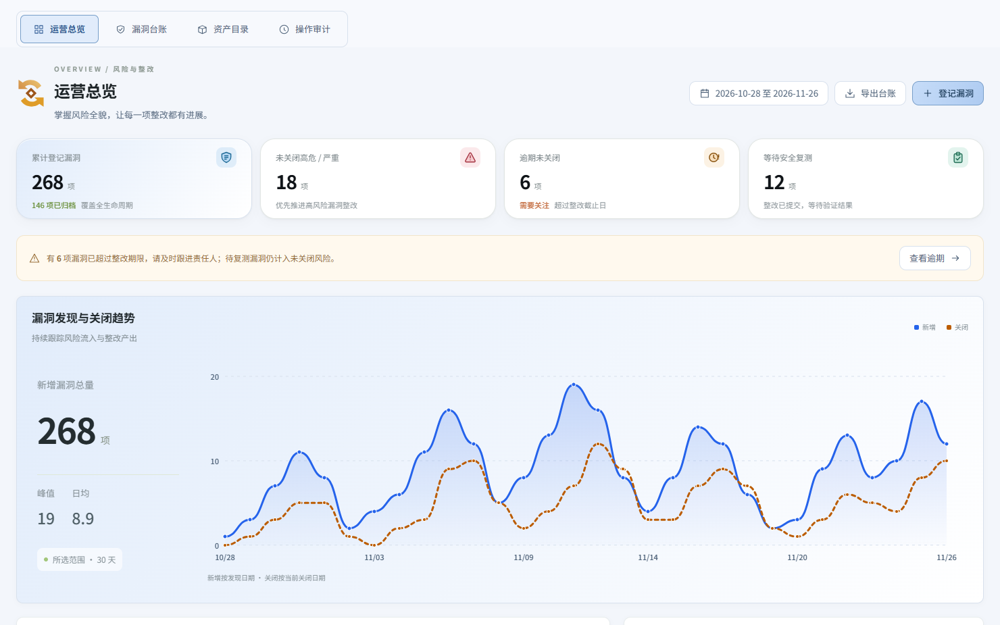
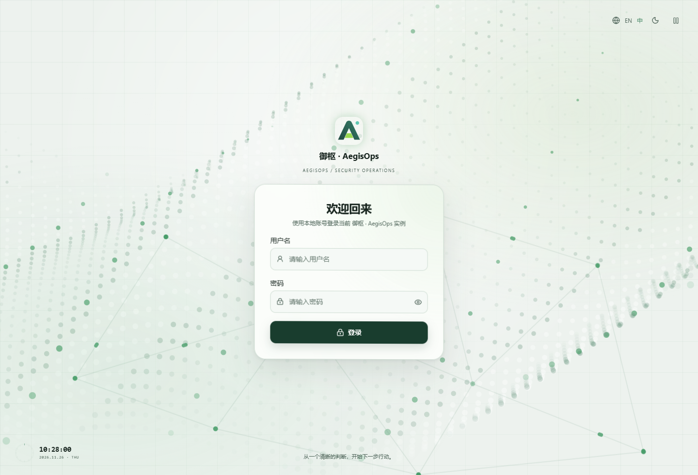

# 2026.11.26 界面截图

截图采自 Chrome 中运行的 **AegisOps 2026.11.26** 发行界面。事件、对话、任务和统计均为演示数据，不包含真实业务信息。

## 工作台首页 · 海盐蓝深色

选择近 30 天后，「任务脉搏」、执行量与成功率使用同一时间范围。

## Atlas 对话与 Worker · 青岚浅色

消息使用卡片排版，右侧独立展示 Worker 执行状态。

## 任务执行记录 · 暮紫深色

展示日期与优先级筛选，以及运行中、已完成和失败等状态。

## 工作流节点详情 · 暮紫浅色

从失败的执行记录打开详情，可直接查看节点顺序和失败原因。

## 应急响应 · 海盐蓝浅色

默认进入事件台账；点击详情进入该事件的调查步骤和活动记录。

## 漏洞运营 · 海盐蓝深色与浅色

两张图都选择近 30 天，日期范围为 2026 年 10 月 28 日至 11 月 26 日。新增与关闭使用不同颜色，并在两种模式下保持可辨识。

## 登录页 · 浅色

展示流动背景的一帧，以及浅色主题的登录卡片。

